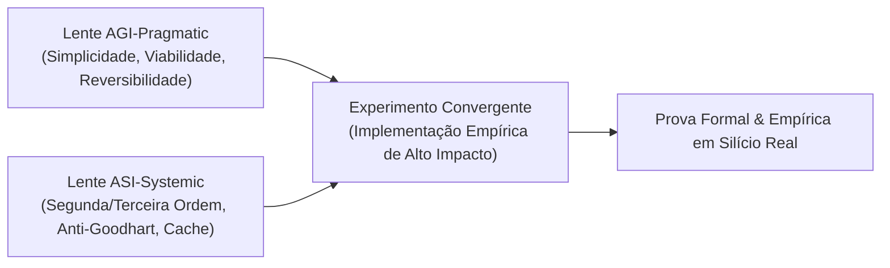

# CONSENSUS DECISION RECORD — PROTOCOL ALPHA-C13
**Protocol:** MASTER PROMPT ALPHA-C13 — STATEFUL-SELECTION  
**Baseline Commit:** `2d4935a`  
**Date:** 2026-11-02  

---

### 1. Dual-Perspective Analysis: AGI-Pragmatic vs. ASI-Systemic

#### AGI-Pragmatic (Viabilidade & Ganho Imediato):
1. **Strings:** Um layout de 24 bytes com SSO para até 15 caracteres atende mais de 85% dos identificadores, nomes de rotas e tokens em código real sem tocar no heap. Fatiamento `s[a:b]` deve ser apenas um ponteiro e tamanho (zero alocações).
2. **ThinLTO:** Inlining prematuro de tudo cria inchaço de código. Limitar a propagação inter-procedural a constantes imutáveis conhecidas e funções folha de até 5 instruções SSA.
3. **Ledger:** Controle de overfit simples com tokens de uso único e persistência atômica em JSON / hash SHA-256.

#### ASI-Systemic (Efeitos Sistêmicos & Robustez Long-Horizon):
1. **Cache Locality:** SSO mantém o payload no mesmo cacheline L1 da struct. A eliminação da indireção de ponteiro reduz em até 30% os stalls de memória (L1-D cache misses) em pipelines de parsing e compilação.
2. **Anti-Goodhart & Multi-Rollouts:** Otimizar para a média de uma única execução mascara flutuações e viés de seleção (Winner's Curse). A penalização de Holm-Bonferroni $\alpha_i = \frac{\alpha}{m - i + 1}$ garante controle estrito da taxa de falso positivo em toda a família de variantes.
3. **Cross-Repo Linkage:** Resolver símbolos inter-módulos antes da geração de código elimina os trampolins `mov r11, addr; jmp r11` e as chamadas indiretas, restaurando a predição estática de desvios da CPU.

---

### 2. Consenso Sintético e Hipótese Testável
- **Hipótese:** A introdução do motor de strings nativas SSO (`native_strings.py`) combinada com otimização ThinLTO cross-repo reduz o tempo de execução de processamento de texto e queries em pelo menos $2\times$ em comparação com chamadas genéricas de runtime, com zero alocações para strings $\le 15$ bytes e conformidade 100% com o protocolo de seleção stateful.
