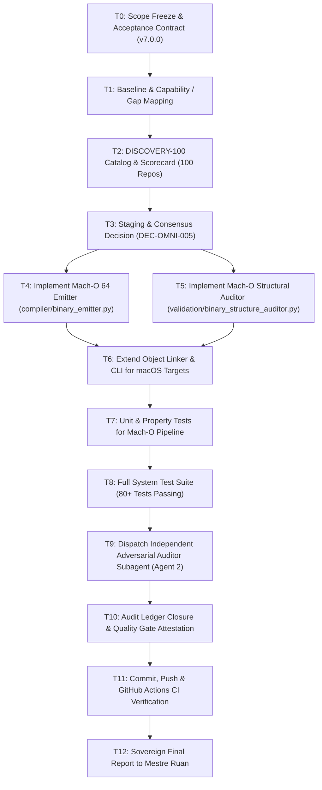

# EXECUTION DAG — ALPHA-C7 DISCOVERY-100
**Protocol:** MASTER PROMPT ALPHA-C7 DISCOVERY-100  
**Version:** 7.0.0  
**Audit Nonce:** `NONCE-C7-20261026-DISCOVERY100`  

### Tasks & Responsibilities
- **T0–T3:** Completed (Scope, Baseline, 100 Repos Catalog, Staging, Consensus).
- **T4–T7:** Principal Builder implementation of Mach-O 64-bit emitter, linker, auditor, and CLI integration.
- **T8:** Local verification suite.
- **T9–T10:** Independent Adversarial Auditor evaluation and score attestation.
- **T11–T12:** Remote synchronization and final report.
