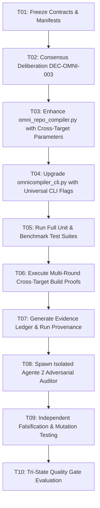

# EXECUTION DAG — ALPHA-C3 IMPLEMENTATION PLAN
**Protocol:** ALPHA-C3 Evidence-Driven Engineering  
**Version:** 3.0.0  
**Baseline Commit:** `700ecbae2c7e156cadf71d3def08076ea6574bde`  

---

### Task DAG Graph

---

### Task Details & Dependencies

| Task ID | Task Description | Dependencies | Output Artifacts | Status |
| :--- | :--- | :--- | :--- | :--- |
| `T01` | Scope Freeze & Acceptance Manifest | None | `ACCEPTANCE_CONTRACT.md`, `ACCEPTANCE_MANIFEST.json` | **DONE** |
| `T02` | Epistemic Consensus Deliberation | `T01` | `CONSENSUS_DECISION_RECORD.md` | **DONE** |
| `T03` | Cross-Target Compilation in Compiler Engine | `T02` | `omni_repo_compiler.py` | **IN PROGRESS** |
| `T04` | Universal CLI Target Flags & Dispatch | `T03` | `omnicompiler_cli.py` | **PENDING** |
| `T05` | Unit Regression & Benchmark Verification | `T04` | 53/53 tests PASS, 4/4 axes PASS | **PENDING** |
| `T06` | Multi-Round Cross-Target Build Proofs | `T05` | Emitted PE64, ELF64, ARM64 binaries | **PENDING** |
| `T07` | Evidence Ledger & Run Provenance Records | `T06` | `EVIDENCE_LEDGER.md`, `RUN_PROVENANCE.md` | **PENDING** |
| `T08` | Launch Isolated Subagent Auditor (Agente 2) | `T07` | Subagent Conversation Context | **PENDING** |
| `T09` | Independent Falsification & Mutation Analysis | `T08` | `ADVERSARIAL_AUDIT_REPORT.md` | **PENDING** |
| `T10` | Final Tri-State Quality Gate Decision | `T09` | `TRI_STATE_QUALITY_GATE.md` | **PENDING** |
