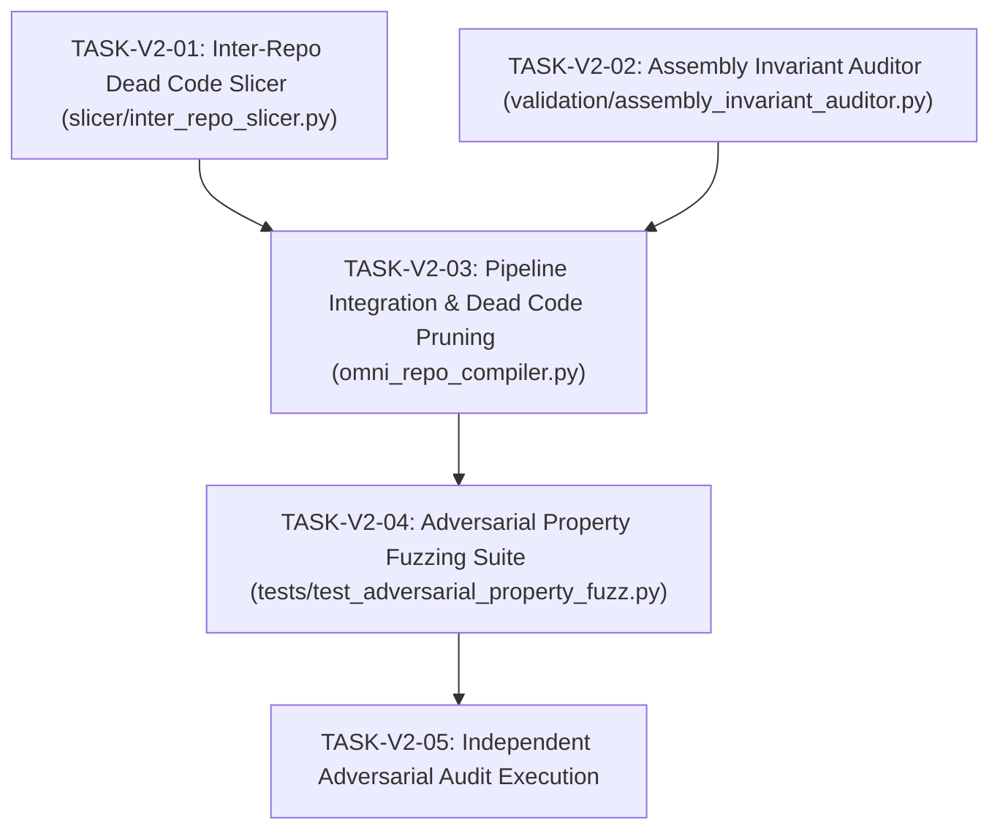

# Execution Roadmap & Dependency-Aware DAG V2
**Protocol:** Dual-Agent Evidence-Driven Engineering  
**Date:** 2026-10-21  

---

## 1. Dependency Graph

---

## 2. Atomic Task Breakdown

### [TASK-V2-01] Inter-Repository Program Dependence Slicer
- **File:** `slicer/inter_repo_slicer.py`
- **Objective:** Traverse the call graph in the Persistent CPG to compute the transitive closure of reachable functions from root entry points (`omni_main`). Prune all dead functions across all ingested repositories.
- **Acceptance Criterion:** Given a repository with 5 unreferenced dead functions and 1 referenced function, the slicer retains only the referenced function.
- **Test:** `tests/test_inter_repo_slicer.py`

### [TASK-V2-02] Assembly & ABI Invariant Auditor
- **File:** `validation/assembly_invariant_auditor.py`
- **Objective:** Verify physical machine code invariants:
  1. Every function terminates with a legitimate return sequence (`0xC3` / `RET` or tail-call).
  2. Stack adjustments (`sub rsp, imm` / `add rsp, imm`) are balanced and maintain 16-byte alignment at call boundaries.
  3. All relative branch and call targets (`E8 disp32`) fall strictly within $[-2^{31}, 2^{31}-1]$.
- **Acceptance Criterion:** Reports valid on compliant machine code; detects and rejects unbalanced stack mutations or truncated displacements.
- **Test:** `tests/test_assembly_invariant_auditor.py`

### [TASK-V2-03] OmniRepo Pipeline Integration
- **File:** `omni_repo_compiler.py`
- **Objective:** Connect the Inter-Repo Slicer and Assembly Invariant Auditor into the `OmniRepoCompiler.compile_repositories` pipeline as formal stages:
  - Stage 2.5: Dead Code Elimination & Program Slicing
  - Stage 6.2: Machine Code Assembly Invariant Verification
- **Acceptance Criterion:** End-to-end multi-repo test passes with dead code pruned and assembly invariants verified.
- **Test:** `test_omni_repo_compiler_e2e.py`

### [TASK-V2-04] Adversarial Property-Based Fuzzing Suite
- **File:** `tests/test_adversarial_property_fuzz.py`
- **Objective:** Use `hypothesis` to generate hundreds of arbitrary 64-bit integer test cases across boundaries ($0, 1, -1, 2^{63}-1, -2^{63}, 2^{31}-1$). Test ABI trampoline consistency, CEGIS parameter synthesis stability, and SMT bitvector equivalence.
- **Acceptance Criterion:** Zero crashes, zero unhandled exceptions, 100% property preservation.

### [TASK-V2-05] Independent Adversarial Audit Execution
- **Role:** Agent 2 (Adversarial Auditor)
- **Objective:** Execute independent hostile tests, mutation tests, and invariant checks to independently verify Agent 1's implementation. Produce `ADVERSARIAL_AUDIT_REPORT.md` and `TRI_STATE_QUALITY_GATE.md`.
