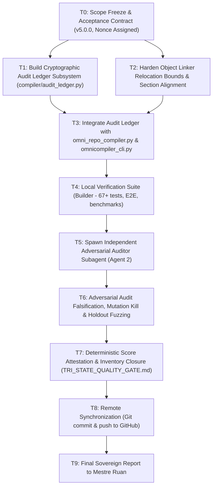

# EXECUTION DAG (ALPHA-C5)
**Protocol:** MASTER PROMPT ALPHA-C5  
**Version:** 5.0.0  
**Audit Nonce:** `NONCE-C5-20261023-OMNI01`  

### Task Specifications & Dependencies
- **T0:** Freeze `ACCEPTANCE_CONTRACT.md` and `ACCEPTANCE_MANIFEST.json` with SHA-256 digests. *(Completed)*
- **T1:** Implement `compiler/audit_ledger.py` with HMAC/SHA-256 signatures, Merkle source root computation, and receipt validation.
- **T2:** Implement relocation boundary checking and alignment invariants in `compiler/object_linker.py` and `validation/binary_structure_auditor.py`.
- **T3:** Integrate CLI subcommands `--sign-ledger` and `audit-attest`.
- **T4:** Run full local test suite (unit tests, property fuzz tests, mutations, cross-target compilation).
- **T5:** Dispatch task to Independent Adversarial Auditor subagent (Agent 2).
- **T6:** Adversarial Auditor verifies all gates independently without builder intervention.
- **T7:** Compile receipts into `EVIDENCE_LEDGER.md`, calculate deterministic score (Section 8B), and sign `TRI_STATE_QUALITY_GATE.md`.
- **T8:** Push changes to GitHub and confirm clean CI status.
- **T9:** Issue Radical Truth Report to Mestre Ruan.
