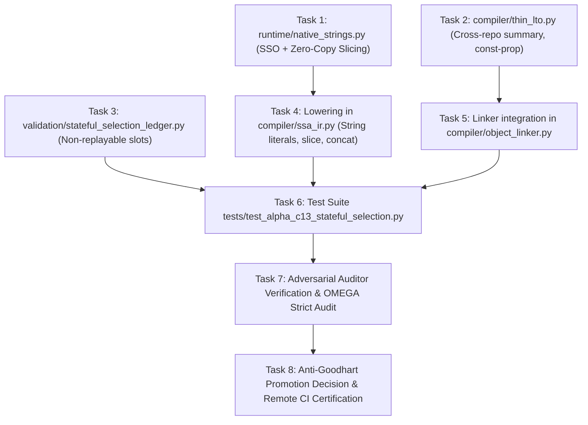

# EXECUTION DAG & ROLLBACK PLAN — PROTOCOL ALPHA-C13
**Protocol:** MASTER PROMPT ALPHA-C13 — STATEFUL-SELECTION  
**Baseline Commit:** `2d4935a`  
**Rollback SHA-256:** `2d4935a004eb7f5b33be1e3093246ebcfd3d0f04`  

---

### 1. Directed Acyclic Graph (DAG) of Changes

---

### 2. Task Specification & Risk Classification

| Task ID | Component / File | Risk Level | Rollback Method | Acceptance Criterion |
| :--- | :--- | :---: | :--- | :--- |
| `TASK-C13-01` | `runtime/native_strings.py` | LOW | Delete file | SSO $\le 15$ bytes inline; heap $> 15$ bytes; zero-copy slice descriptor. |
| `TASK-C13-02` | `compiler/thin_lto.py` | LOW | Delete file | Inlines leaf functions across repos; propagates cross-repo constants. |
| `TASK-C13-03` | `validation/stateful_selection_ledger.py` | LOW | Delete file | Atomic token consumption; Holm-Bonferroni correction calculation. |
| `TASK-C13-04` | `compiler/ssa_ir.py` & `runtime/native_heap.py` | MEDIUM | `git checkout compiler/ssa_ir.py` | String constants, `.startswith()`, slicing lowered to native C-ABI. |
| `TASK-C13-05` | `compiler/object_linker.py` & `compiler/native_jit.py` | LOW | `git checkout compiler/object_linker.py` | Auto-resolves `omni_str_*` runtime symbols in JIT and DLL link. |
| `TASK-C13-06` | `tests/test_alpha_c13_stateful_selection.py` | LOW | Delete file | 100% pass on all C13 test cases across repeated rollouts. |
| `TASK-C13-07` | `AetherMind_Strict_Auditor.py` | AUDIT | Fix code defects | Auditor issues `APROVADO`. Zero false claims. |
| `TASK-C13-08` | Commit & Push | HIGH | `git revert HEAD` | Remote GitHub Actions CI passes 100% of workflow jobs. |
