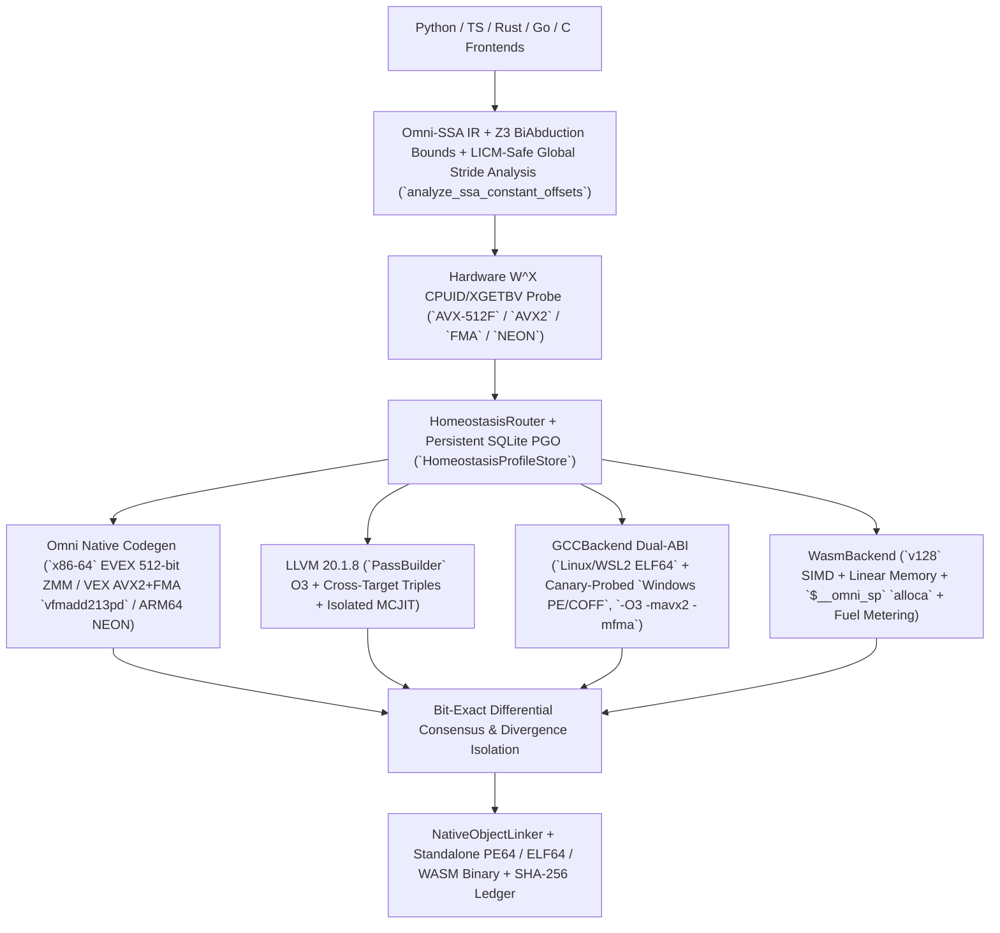

# Final Architecture Overview — Tri/Quad-Ecosystem Homeostasis (`Alpha-C62` → `Alpha-C65`)

## Key Verified Capabilities Across Milestones C62–C65
- **Alpha-C62:** `GCCBackend` (zero-UB C99/GNU-C, two-phase $\phi$-copies, `-fPIC` RIP-relative ELF64), `LLVMBackend` cross-target triples (`aarch64` etc.) & MCJIT `TargetMachine` isolation, initial Tri-Ecosystem `HomeostasisRouter`.
- **Alpha-C63:** `WasmBackend` linear-memory & `alloca` execution (`run_ssa_with_memory`), Quad-Ecosystem differential consensus (`Native == LLVM 20 == GCC O3 == Wasmtime v128`), build-time `homeostasis_probes` & Z3 `verify_ssa_to_wat`, and centralized `analyze_ssa_constant_offsets` solving post-LICM SIMD degradation across x86-64/ARM64/WASM.
- **Alpha-C64:** W^X `CPUID`/`XGETBV(0)` probing, VEX 256-bit FMA (`vfmadd213pd`/`ps`/`sd`), EVEX 512-bit AVX-512 kernels verified with GNU `objdump` & live CI AVX-512 silicon execution, Dual-ABI canary-verified `GCCBackend`.
- **Alpha-C65:** Automatic 8-lane 512-bit EVEX ZMM fusion in `X64CodeGenerator`, VEX FMA horizontal dot-product (`vfmadd231pd` + `vhaddpd`), persistent SQLite PGO engine selector (`HomeostasisProfileStore`), and unified 4-ecosystem benchmark (`comparative_benchmark.py`).
