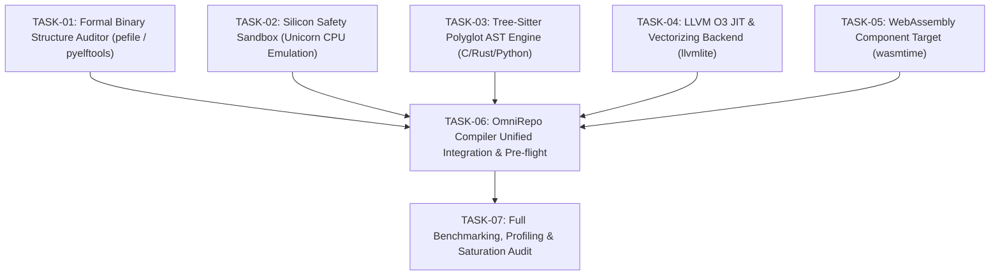

# Implementation Roadmap — Dependency-Aware Execution DAG

This roadmap defines the atomic tasks, dependencies, acceptance criteria, test strategies, and rollback plans for integrating the 5 approved state-of-the-art components into **OmniCompiler**.

---

## Execution DAG

---

## Atomic Task Specifications

### [TASK-01] Formal Binary Structure Auditor
- **ID:** `TASK-01-BIN-AUDITOR`
- **Module:** `validation/binary_structure_auditor.py`
- **Component:** `pefile` (2024.8.26) & `pyelftools` (0.33)
- **Objective:** Audit every emitted PE/COFF (`.dll`, `.exe`) and ELF (`.so`, ELF executable) binary against formal OS loader specs. Verify image base, machine type, section alignment, relocation tables (`IMAGE_DIRECTORY_ENTRY_BASERELOC`), and exported function symbols.
- **Acceptance Criteria:** `audit_pe_binary(data)` and `audit_elf_binary(data)` return a structured `BinaryAuditReport` confirming 100% specification compliance.
- **Test:** `tests/test_binary_structure_auditor.py`
- **Rollback:** Module is isolated; fallback to existing basic header checks.

### [TASK-02] Silicon Safety Sandbox (Unicorn CPU Emulation)
- **ID:** `TASK-02-UNICORN-SANDBOX`
- **Module:** `validation/silicon_safety_sandbox.py`
- **Component:** `unicorn` (2.1.4)
- **Objective:** Provide a pre-flight emulation sandbox for emitted x86-64 machine code. Executes instructions in a virtual CPU with simulated RAM and stack. Detects illegal opcodes, unmapped memory reads/writes, stack overflows, and verifies register return values (`RAX`) BEFORE passing execution to host physical silicon (`ctypes`).
- **Acceptance Criteria:** Emulates execution of synthesized machine code, returns output register state, raises explicit `CpuEmulationError` on violations without crashing the host OS.
- **Test:** `tests/test_silicon_safety_sandbox.py`
- **Rollback:** Bypass pre-flight sandbox and jump directly to host execution.

### [TASK-03] Tree-Sitter Polyglot AST Engine
- **ID:** `TASK-03-TREESITTER-AST`
- **Module:** `slicer/tree_sitter_polyglot.py` & update `orchestrator/repo_manifest_ingestor.py`
- **Component:** `tree-sitter` (0.25.2) + `tree-sitter-language-pack` (0.13.0)
- **Objective:** Parse C/C++ header files, Rust `src/lib.rs` files, and Python source files into standard syntax trees. Extract exact function prototypes, parameters, return types, struct field declarations, and export qualifiers (`extern "C"`, `pub fn`) without brittle regex heuristics.
- **Acceptance Criteria:** Extracts complete symbol signatures, structs, and interfaces from C header files and Rust code with 100% syntax tree fidelity.
- **Test:** `tests/test_tree_sitter_polyglot.py`
- **Rollback:** Retain existing regex-based parser as fallback.

### [TASK-04] LLVM O3 Optimizing JIT Backend
- **ID:** `TASK-04-LLVM-BACKEND`
- **Module:** `compiler/llvm_backend.py`
- **Component:** `llvmlite` (0.47.0)
- **Objective:** Compile OmniCompiler SSA intermediate representation into LLVM IR. Run LLVM target machine optimization passes (`create_pass_manager_builder()`, opt level 3), compile to native machine code in memory or emit object files (`.obj`/`.o`) and shared libraries with vectorization and dead code elimination.
- **Acceptance Criteria:** Successfully lowers SSA instructions to LLVM IR, optimizes with O3 pass manager, compiles to callable native function pointer, and achieves speedup over unoptimized baseline machine code.
- **Test:** `tests/test_llvm_backend.py`
- **Rollback:** Fall back to custom SSA machine emitter.

### [TASK-05] WebAssembly Sandboxed Target
- **ID:** `TASK-05-WASMTIME-TARGET`
- **Module:** `compiler/wasm_backend.py`
- **Component:** `wasmtime` (49.0.0)
- **Objective:** Compile synthesized functions and inter-repo glue logic into WebAssembly bytecode (`.wasm`). Execute in Wasmtime engine with memory isolation, deterministic execution limits, and zero host memory tampering risk.
- **Acceptance Criteria:** Generates valid WASM binary, instantiates in Wasmtime runtime, executes exported functions and verifies return values.
- **Test:** `tests/test_wasm_backend.py`
- **Rollback:** Disable WASM target; use native backend only.

### [TASK-06] OmniRepo Compiler Unified Integration & Pre-flight
- **ID:** `TASK-06-UNIFIED-PIPELINE`
- **Module:** Update `omni_repo_compiler.py` and `cli.py`
- **Objective:** Wire the new components into the end-to-end pipeline:
  1. Tree-Sitter ingestion of C/Rust/Python.
  2. Persistent CPG with cross-repo dependency topology.
  3. CEGIS parameter synthesis + Universal ABI bridge.
  4. Backend selection: LLVM O3 JIT, Native PE/ELF Linker, or Wasmtime target.
  5. Pre-flight silicon safety verification via Unicorn CPU emulator.
  6. Formal PE/ELF binary structure audit via pefile/pyelftools.
  7. Physical execution and benchmark reporting.
- **Acceptance Criteria:** End-to-end test passes with all 5 new components cooperating in the pipeline.
- **Test:** `test_omni_repo_compiler_e2e.py` (updated to include all stages).

### [TASK-07] Full Benchmarking, Profiling & Saturation Audit
- **ID:** `TASK-07-BENCHMARK-SATURATION`
- **Objective:** Measure baseline vs. post-integration throughput, execution latency, memory footprint, and compile times. Execute recursive closed-loop discovery and verify technological saturation criteria.
- **Acceptance Criteria:** Comprehensive benchmark report generated, all test suites passing, zero regressions.
